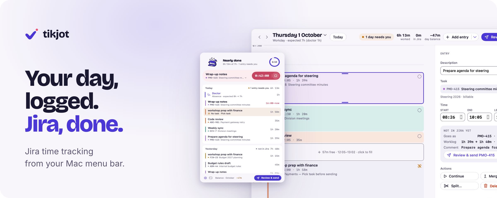
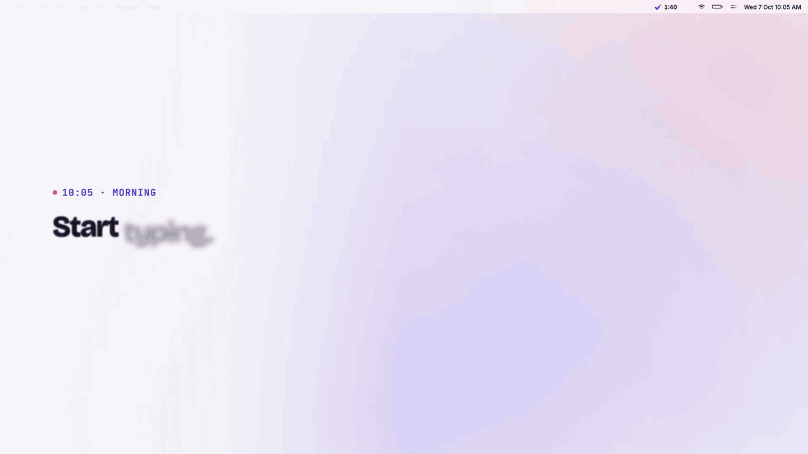
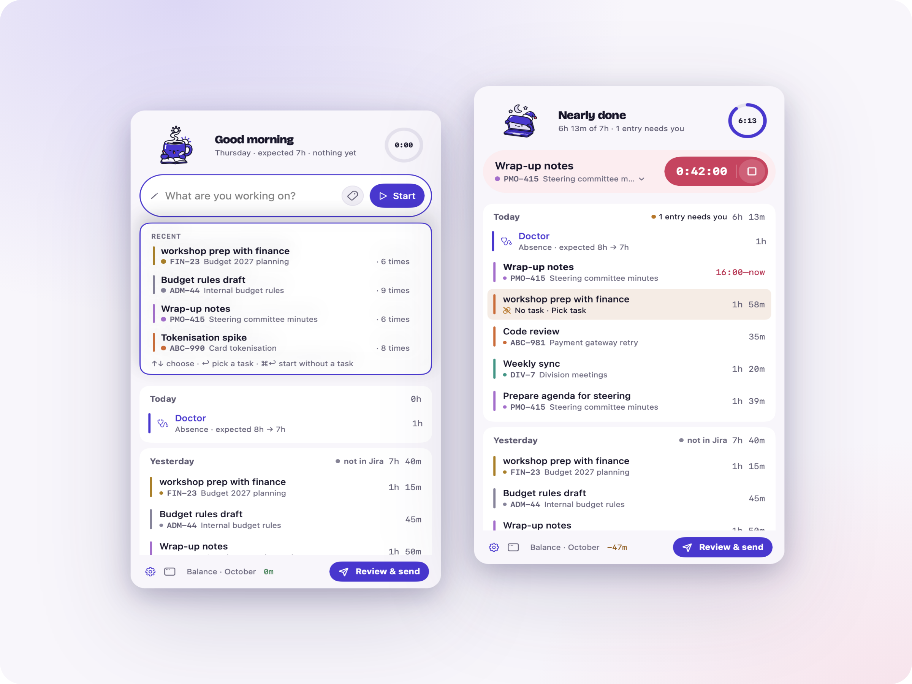
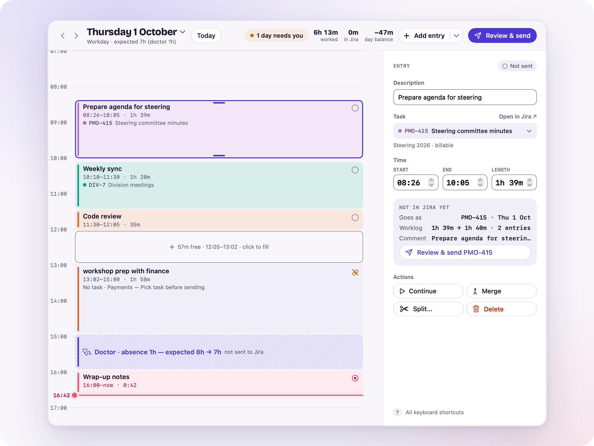
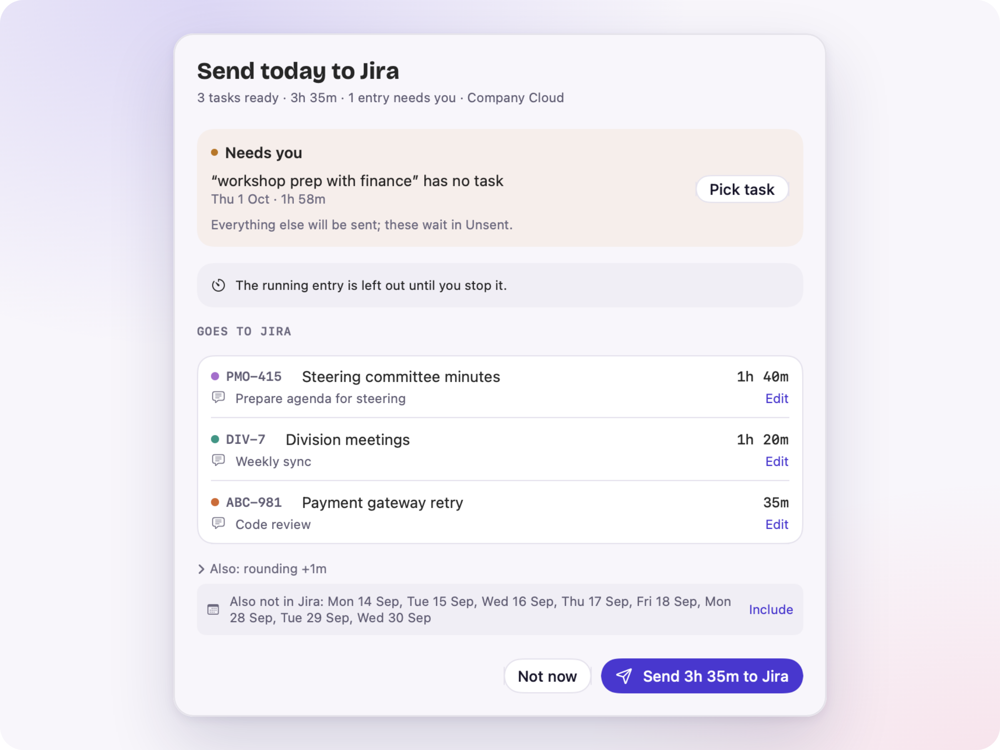

<picture>
  <source media="(prefers-color-scheme: dark)" srcset=".github/readme/hero-dark.png">
  
</picture>

# tikjot

**Jira time tracking from your Mac menu bar.** Start a timer with one click, fix your day like a calendar,
and send one tidy worklog per task and day to Jira. Only when you press Send.

[](LICENSE)




## Install

1. Download the latest **tikjot.dmg** from [Releases](https://github.com/rashowall/tikjot/releases/latest).
2. Open it and drag **tikjot** to Applications.
3. Start it, connect your Jira (Cloud or Data Center) and pick your working hours.

Requires **macOS 14 Sonoma** or later. Free. tikjot updates itself and asks before installing an update.

## How it works

### Track from the menu bar
Type what you're working on and press Start, or continue yesterday's task. The timer lives in the menu bar.

<picture>
  <source media="(prefers-color-scheme: dark)" srcset=".github/readme/feature-pop-dark.png">
  
</picture>

### Fix your day like a calendar
Every entry is a block on a timeline. Drag, split, merge or fill a gap. tikjot shows what still needs you.

<picture>
  <source media="(prefers-color-scheme: dark)" srcset=".github/readme/feature-day-dark.png">
  
</picture>

### Review & send to Jira
See exactly what goes to Jira (one worklog per task and day), then send it in one go.

<picture>
  <source media="(prefers-color-scheme: dark)" srcset=".github/readme/feature-review-dark.png">
  
</picture>

## Features

- One-click timer in the menu bar (⌥⌘T from anywhere); continue any recent task.
- Day, Week and Month views; a timeline you edit like a calendar.
- Review before sending: one worklog per task and day, updates instead of duplicates, rounding you choose, undo right after.
- Monthly balance (worked vs. working-time fund) and utilization; absences (vacation, doctor) and public holidays for 24 countries.
- Jira Cloud and Jira Data Center, also moving from one to the other.
- Desktop widget, light and dark, English and Slovak.

## Privacy

- **No server, no account, no telemetry.** tikjot runs on your Mac only.
- **Encrypted.** Your time data is encrypted at rest (SQLCipher); your Jira token lives in the Keychain.
- **Talks only to your Jira**, and writes worklogs only when you press Send.
- The one other request is the daily **update check** to GitHub Releases. It sends nothing about you or your Mac.

More, written so you can forward it to your IT team: [tikjot.com/privacy](https://tikjot.com/privacy.html).

## Build from source

```sh
brew install xcodegen
xcodegen generate        # creates tikjot.xcodeproj from project.yml
scripts/build.sh         # or: open tikjot.xcodeproj
```

Set your own team in `project.yml` (`DEVELOPMENT_TEAM`). Try it without Jira or your own data:
`scripts/run-demo.sh` (in-memory data and a mock Jira). Tests, project layout and releasing: [DEVELOPMENT.md](DEVELOPMENT.md).

## Contributing & support

tikjot is built by one person, so support is best effort. Bugs go to [Issues](https://github.com/rashowall/tikjot/issues/new/choose),
ideas and questions to [Discussions](https://github.com/rashowall/tikjot/discussions). Before a pull request, see
[CONTRIBUTING.md](CONTRIBUTING.md). Please report security problems privately, see [SECURITY.md](SECURITY.md).

## License

tikjot is free software under the [GNU General Public License v3.0](LICENSE). The name, logo, app icon and
illustrations are not covered by the GPL, see [TRADEMARKS.md](TRADEMARKS.md). A fork is welcome, under its own name
and look. Third-party licenses: [THIRD_PARTY_NOTICES.md](THIRD_PARTY_NOTICES.md).

<sub>Jira and Atlassian are trademarks of Atlassian; Mac and macOS of Apple Inc. tikjot is an independent project,
not affiliated with or endorsed by either.</sub>
